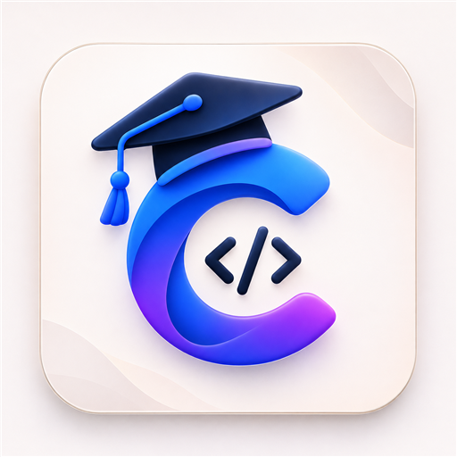

  

<h1 align="center">Codenixa Business Studio</h1>

  <b>Build the digital product your business actually runs on.</b> 
  A client workspace for commissioning websites, e-commerce, web apps and mobile apps.

  
  
  

---

> **This is a presentation repository.** It describes the product, its process and its
> approved branding. Application source code, client data and billing records are private
> and are not published here.

---

## What it is

**Codenixa Business Studio** is a dedicated client workspace for commissioning professional
digital products. Instead of scattered chat threads and informal quotes, everything lives in
one place — from first enquiry to final handover.

Clients see **every proposal, milestone, invoice and conversation** attached to their project.

### What gets built

| Service | Typical outcome |
| --- | --- |
| **Professional business websites** | Corporate, portfolio, real-estate, education, healthcare and local business sites |
| **E-commerce websites** | Product catalogues, carts, checkout, order management and payments |
| **Custom web applications** | Booking systems, CRMs, dashboards, portals and internal business tools |
| **Mobile app development** | iOS and Android projects scoped, designed and built with Codenixa |

Each project is quoted individually after requirements are understood — there is no public
fixed rate, and the studio does not publish one.

---

## How a project runs

Six stages, nothing hidden. You always know which stage a project is in, what is expected of
you, and what comes next.

| # | Stage | What happens |
| --- | --- | --- |
| 1 | **Discover** | Understand the business, audience and outcome |
| 2 | **Plan** | Turn requirements into a written scope |
| 3 | **Design & build** | Design the interface, then develop it |
| 4 | **Review** | Check each milestone before it is closed |
| 5 | **Launch** | Deploy, verify and hand over |
| 6 | **Support** | Fix, extend and maintain after launch |

---

## Why the workspace exists

| | |
| --- | --- |
| **Written scope first** | Deliverables, exclusions, assumptions and a schedule are agreed before development starts |
| **Milestone approvals** | Each milestone that needs sign-off is presented with its files — approval is a deliberate act |
| **Clear financial records** | Invoices, due dates and outstanding balances come from issued records, not estimates |
| **One conversation thread** | Questions, files and decisions stay attached to the project instead of scattered across channels |

---

## Technology

| Layer | Technologies |
| --- | --- |
| **Frontend** | Astro · TypeScript · Custom CSS design system |
| **Data & auth** | Firebase (Auth, Firestore) with deny-by-default security rules |
| **Delivery** | Firebase Hosting with security headers |
| **Testing** | Vitest |

High-level technology names only — no source code, security rules, credentials or client
records are included in this repository.

---

## Notes on the content you'll see on the site

Project examples published on the website are **clearly labelled illustrative examples**
describing the shape of work the studio delivers — they are not presented as published
client results. Pricing is agreed per project in writing before work begins.

---

## 📬 Contact

  
  
  

  © 2026 Codenixa Technology · Codenixa Business Studio. All rights reserved.

